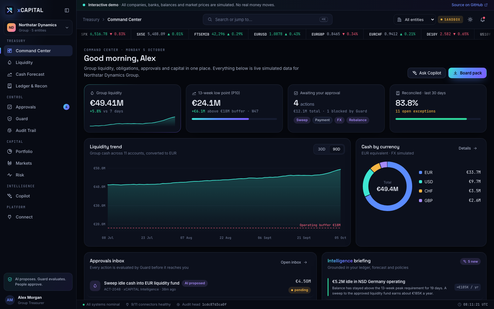
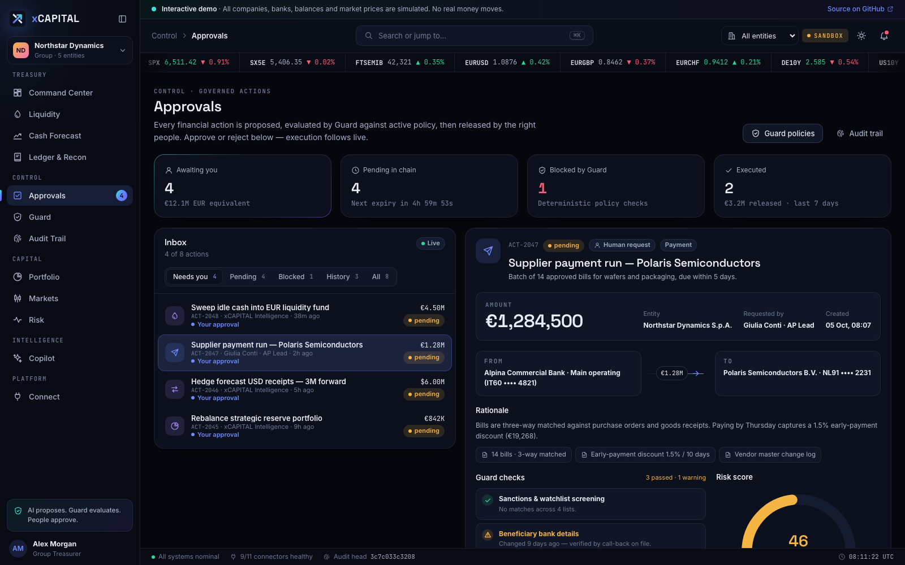
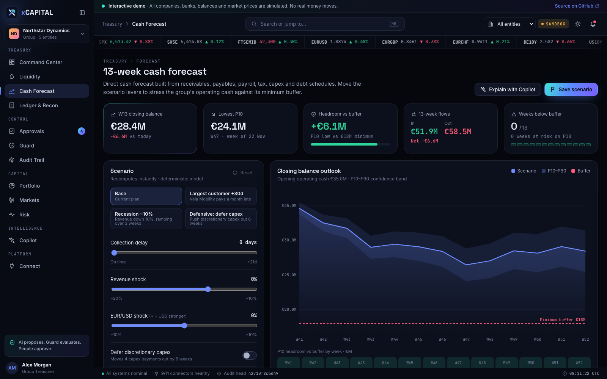
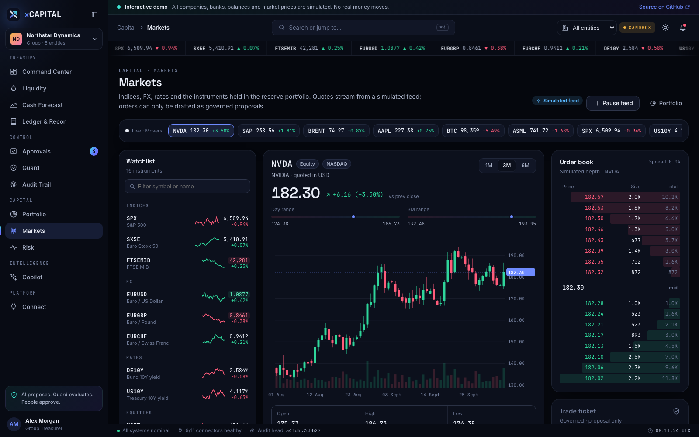
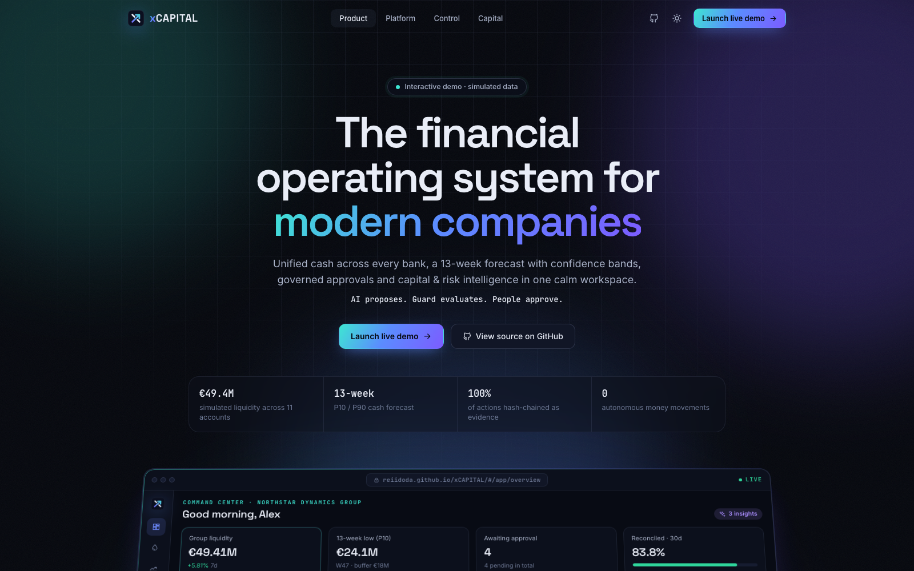
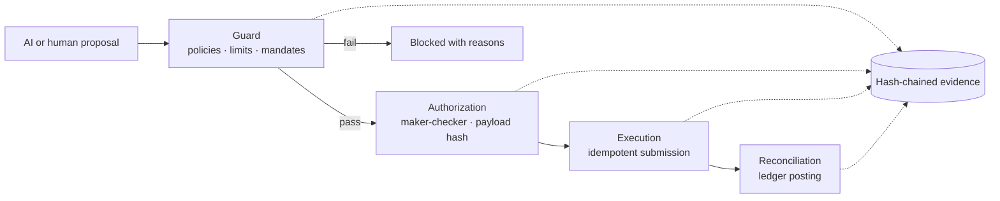

<p align="center">
  
</p>

<p align="center">
  <strong>The financial operating system for modern companies.</strong><br>
  Treasury · 13-week forecasting · Governed approvals · Capital &amp; risk · AI copilot
</p>

<p align="center">
  <a href="https://kokutbon.github.io/xCAPITAL/"><b>Local demo / planned Pages site →</b></a>
  &nbsp;·&nbsp;
  <a href="docs/README.md">Documentation</a>
  &nbsp;·&nbsp;
  <a href="docs/OPERATING_LIMITATIONS.md">Operating limitations</a>
</p>

<p align="center">
  <a href="https://kokutbon.github.io/xCAPITAL/"></a>
</p>

---

xCAPITAL helps a finance team answer four questions:

- Where is our cash?
- What obligations are coming?
- How reliable is the forecast?
- Which financial actions should we approve?

It consolidates bank accounts across entities and currencies, projects liquidity 13 weeks ahead under scenarios, reconciles the ledger, and manages a reserve investment portfolio. An AI copilot explains every number. Every proposed action goes through one governing contract:

> **AI proposes. Deterministic controls evaluate. Authorized people approve. Every material decision is evidenced.**

## Synthetic demo (local; Pages publication pending)

**[kokutbon.github.io/xCAPITAL](https://kokutbon.github.io/xCAPITAL/)** is the planned publication URL for a fully interactive, static build of the web workspace. It runs for **Northstar Dynamics Group**, a fictional company with five entities, eleven bank accounts and a strategic reserve portfolio.

- **Simulated data.** Every company, bank, person, balance and market price is simulated from a deterministic seed anchored to today's date. The demo makes no network calls and moves no money.
- **Real interactions.** You can approve or reject governed actions and watch them execute. You can also flip the kill switch, run forecast scenarios, resolve reconciliation exceptions, re-sync connectors, verify the audit hash chain and ask the copilot questions.

| Area | Module | What you can do |
| --- | --- | --- |
| **Treasury** | Command Center | See group liquidity, the 13-week low point, the approvals inbox, the AI briefing, the reserve portfolio and live activity |
| | Liquidity | Check every account by entity, currency and bank, bank concentration against policy, and account drill-downs |
| | Cash Forecast | Model a 13-week direct forecast with a P10–P90 band, scenario sliders, the obligations schedule and backtest accuracy |
| | Ledger & Recon | Work an exception queue with suggested matches, review transactions, and inspect balanced double-entry journals |
| **Control** | Approvals | Work a maker-checker inbox: Guard checks, risk score, approval chain, immutable payload hash, execution timeline |
| | Guard | Manage the policy engine: limits, mandates, controls, policy-as-code, and the execution kill switch |
| | Audit Trail | Browse the hash-chained evidence log, verify the chain in the browser, and simulate tampering |
| **Capital** | Portfolio | Review the reserve portfolio against a mandate: performance against the benchmark, drift and a rebalance proposal |
| | Markets | Follow a simulated streaming feed with candlesticks, a depth ladder and a governed trade ticket |
| | Risk | Review VaR and expected shortfall, factor exposures, a correlation heatmap, stress tests and custom shocks |
| **Intelligence** | Copilot | Ask a grounded, read-only assistant; answers cite their sources and can link to proposals |
| **Platform** | Connect | Monitor bank, ERP, broker and market-data connectors, the ingestion pipeline and the developer API |

<table>
  <tr>
    <td width="50%"></td>
    <td width="50%"></td>
  </tr>
  <tr>
    <td width="50%"></td>
    <td width="50%"></td>
  </tr>
</table>

## How control works



- **Proposals are versioned intents.** An approval binds to one immutable payload hash. If the payload is amended, earlier approvals are invalidated.
- **Guard is deterministic.** It checks payment limits, dual-approval thresholds, operating buffers, mandates, hedge bands, bank concentration, beneficiary cooling-off periods and sanctions screening. Models never grant themselves authority.
- **A kill switch freezes new submissions instantly.** Anything already submitted must be recovered with the provider.

The backend implementation of this boundary is documented in [EXECUTION_APPROVAL_BOUNDARY.md](docs/EXECUTION_APPROVAL_BOUNDARY.md) and [ADR 0004](docs/adr/0004-persisted-execution-approval-boundary.md).

## Repository

The repository holds the whole platform. The live demo publishes only the web client, running on simulated data.

```text
xCAPITAL/
├── frontend/web/          # Angular 21 workspace + product site (the synthetic demo)
├── backend/
│   ├── gateway/           # Spring Cloud Gateway: JWT, org scope, rate limits
│   ├── auth-service/      # Identity, MFA, SSO, SCIM, organizations
│   ├── portfolio-service/ # Capital, trade proposals, execution intents, banking, audit
│   └── simulation-service/# Backtesting and simulation jobs
├── ai/ai-service/         # FastAPI analytics: forecasts, risk, allocation baselines
├── mobile/xcapital_app/   # Flutter client
├── math-library/          # Quantitative formula registry
├── docs/                  # Architecture, ADRs, transformation plan, baseline
└── scripts/               # CI matrices and smoke suites
```

| Layer | Technology |
| --- | --- |
| Web | Angular 21 standalone components and signals; a custom dependency-free SVG chart engine; Inter, Space Grotesk and JetBrains Mono |
| Services | Java 21, Spring Boot 3.3, Spring Cloud Gateway, Spring Data JPA, Flyway |
| Analytics | Python 3.12, FastAPI, NumPy |
| Mobile | Flutter 3 |
| Data | PostgreSQL 16, Redis 7 |
| Delivery | Docker Compose, GitHub Actions (required checks plus GitHub Pages deploy) |

## Run the demo locally

```bash
cd frontend/web
npm ci
npm start
```

Open http://localhost:4200. To build the Pages bundle with base href `/xCAPITAL/`, run `npm run build:pages`.

## Run the full stack

You need Docker Desktop with Compose and about 8 GB of free memory.

```bash
cp .env.example .env
make up
```

| Service | URL |
| --- | --- |
| Web | http://localhost:4200 |
| API gateway | http://localhost:8080 |
| Auth / Portfolio / Simulation | :8081 / :8082 / :8083 |
| AI service | http://localhost:8090 |

Backend tests:

```bash
make test
```

Tenant isolation matrix:

```bash
make tenant-isolation-matrix
```

Mobile tests:

```bash
cd mobile/xcapital_app && flutter test
```

## Project status

xCAPITAL provides financial application services, integration interfaces and synthetic web workflows. Read the [operating limitations](docs/OPERATING_LIMITATIONS.md) before configuring a deployment. Live execution requires environment-specific security, financial correctness and recovery validation; the source distribution does not certify these controls.

## Contributing and security

- [CONTRIBUTING.md](CONTRIBUTING.md)
- [SECURITY.md](SECURITY.md)
- [CODE_OF_CONDUCT.md](CODE_OF_CONDUCT.md)
- [SUPPORT.md](SUPPORT.md)

## Author

Designed and built by **[Rei Doda](https://github.com/reiidoda)**.

## License and disclaimer

Licensed under the [Apache License 2.0](LICENSE).

xCAPITAL is a software demonstration. It is not a bank, broker, payment institution or investment adviser, and nothing in this repository or the demo is financial advice. All companies, institutions, people, balances and prices in the demo are fictional or simulated.

## KOKUTBON community and support

Open technology for the benefit of humankind — built by people, for people, and freely reusable by everyone.

Read [Contributing](CONTRIBUTING.md), [Code of Conduct](CODE_OF_CONDUCT.md), [Support](SUPPORT.md), [Governance](GOVERNANCE.md) and [Security](SECURITY.md). Help sustain the work through [GitHub Sponsors and other contributions](SPONSORSHIP.md). Maintainer release requirements are documented in [Release checklist](RELEASE_CHECKLIST.md).

## Source publication

See [source publication status](SOURCE_PUBLICATION.md) and [local validation record](PUBLICATION_VALIDATION.md) for the initial distribution and remaining release checks.

> **Demo hosting:** GitHub Pages has not been published. Any `kokutbon.github.io` URL above is planned; use the local preview instructions until deployment is verified.
