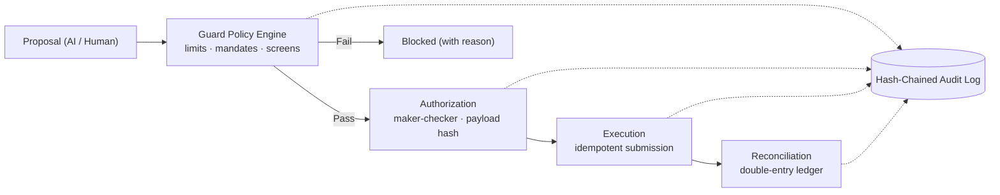

<p align="center">
  
</p>

<p align="center">
  <strong>Corporate treasury, liquidity forecasting, and governed financial controls.</strong><br>
  Treasury · 13-week forecasting · Governed approvals · Capital &amp; risk · Self-hosted stack
</p>

<p align="center">
  <a href="docs/README.md">Documentation</a>
  &nbsp;·&nbsp;
  <a href="docs/OPERATING_LIMITATIONS.md">Operating limitations</a>
  &nbsp;·&nbsp;
  <a href="#quickstart--running-the-stack">Quickstart</a>
  &nbsp;·&nbsp;
  <a href="#synthetic-demo-workspace">Synthetic demo</a>
</p>

---

> ⚠️ **Notice on Production vs. Demonstration:**
> xCAPITAL provides self-hosted financial microservices, double-entry ledger logic, and policy-governed approval workflows. It includes a frontend synthetic workspace operating on deterministic simulated data. A web demonstration does not certify live financial execution, regulatory compliance, or physical treasury readiness. Review [Operating Limitations](docs/OPERATING_LIMITATIONS.md) before deploying.

---

## What is xCAPITAL

xCAPITAL is a multi-tier financial operating and treasury management platform designed around one governing contract:

> **AI proposes. Deterministic controls evaluate. Authorized people approve. Every material decision is evidenced.**

- **Liquidity & Cash Forecasting:** Consolidates multi-entity, multi-currency accounts and models direct 13-week cash flow forecasts with P10–P90 confidence intervals.
- **Governed Maker-Checker Approvals:** Immutable payload hashing, policy limit evaluation, dual-approval thresholds, and execution kill switches.
- **Double-Entry Ledger:** Real-time transaction reconciliation, exception tracking, and balanced journal entries.
- **Audit Hash Chain:** Cryptographically verifiable audit trail recording all intents, evaluations, and authorizations.

---

## Quickstart / Running the Stack

### Requirements
- Docker Desktop with Compose (v2.20+)
- 8 GB free RAM
- (Optional for native dev) Java 21, Python 3.12, Node.js 20+, Flutter 3

### 1. Run the Full Stack via Docker Compose

```bash
cp .env.example .env
make up
```

| Service | Port / URL | Description |
| :--- | :--- | :--- |
| **Web UI** | http://localhost:4200 | Angular 21 workspace |
| **API Gateway** | http://localhost:8080 | Spring Cloud Gateway (auth, rate limits) |
| **Backend Services** | :8081 / :8082 / :8083 | Auth, Portfolio & Treasury, Simulation |
| **AI Analytics** | http://localhost:8090 | FastAPI quantitative engine |

### 2. Run Backend & Isolation Tests

```bash
# Run Maven backend tests
make test

# Verify tenant isolation matrix across PostgreSQL schemas
make tenant-isolation-matrix
```

---

## Synthetic Demo Workspace

The web client (`frontend/web`) includes a zero-dependency simulated environment for **Northstar Dynamics Group** (a fictional group with 5 entities and 11 bank accounts). All company names, banks, balances, and market feeds are synthetic.

To run the standalone web demo locally:

```bash
cd frontend/web
npm ci
npm start
```
Open http://localhost:4200.

---

## System Architecture



### Repository Structure

```text
xCAPITAL/
├── backend/
│   ├── gateway/           # Spring Cloud Gateway: JWT, org scope, rate limits
│   ├── auth-service/      # Identity, MFA, SSO, SCIM, organizations
│   ├── portfolio-service/ # Capital, trade proposals, execution intents, banking, audit
│   └── simulation-service/# Backtesting and simulation jobs
├── ai/ai-service/         # FastAPI analytics: forecasts, risk, allocation baselines
├── frontend/web/          # Angular 21 workspace (interactive client)
├── mobile/xcapital_app/   # Flutter client
├── math-library/          # Quantitative formula registry
├── docs/                  # Architecture, ADRs, transformation plan, baseline
└── scripts/               # CI matrices and smoke suites
```

---

## Operating Limitations & Disclaimer

- **Operating Limitations:** Detailed operational boundaries and security prerequisites are specified in [OPERATING_LIMITATIONS.md](docs/OPERATING_LIMITATIONS.md).
- **Disclaimer:** xCAPITAL is open-source software under [Apache-2.0](LICENSE). It is not a bank, broker, or financial adviser. Real-money operations require independent security and regulatory auditing.

---

## Community & Stewardship

- [CONTRIBUTING.md](CONTRIBUTING.md)
- [SECURITY.md](SECURITY.md)
- [GOVERNANCE.md](GOVERNANCE.md)
- [CODE_OF_CONDUCT.md](CODE_OF_CONDUCT.md)
